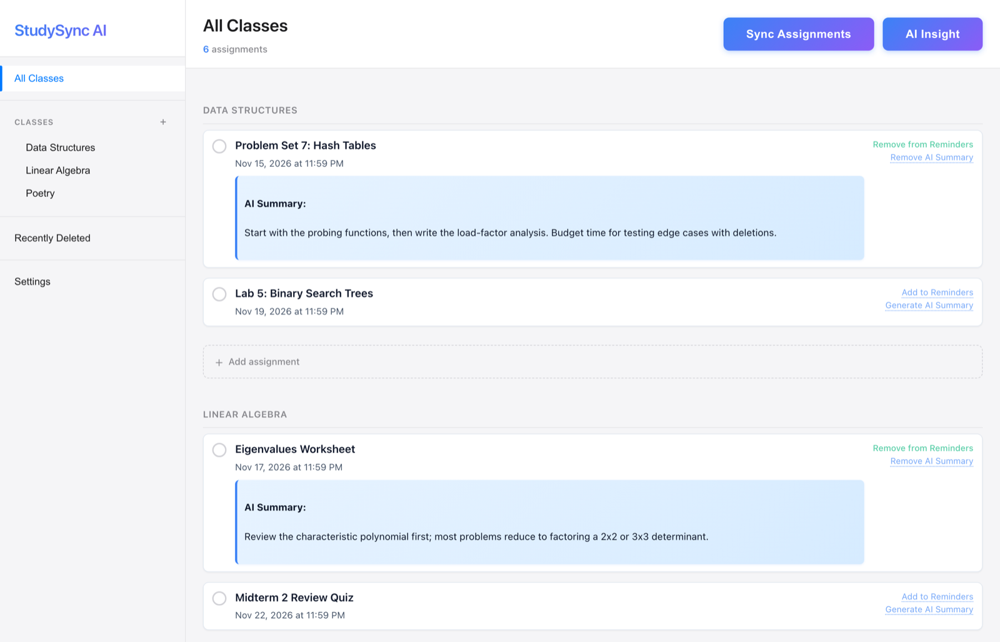
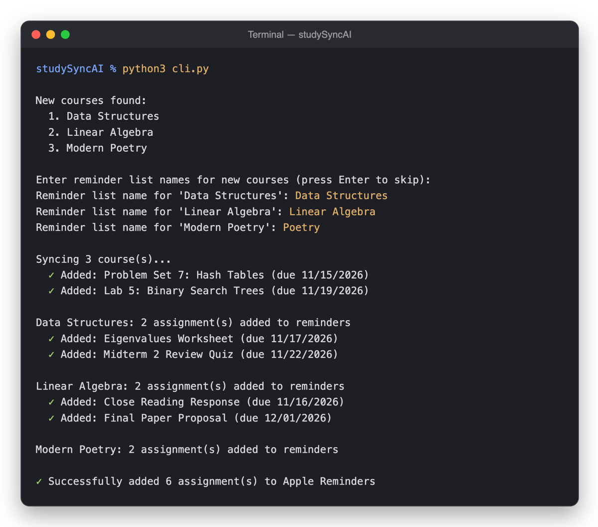

# StudySync AI

A local macOS tool that brings Canvas assignments into Apple Reminders, with a browser dashboard and optional AI summaries through a local Ollama model.

The project is free and open source. Use your own Canvas account. Assignment data stays in a local SQLite database; Canvas requests go to your configured school, and AI requests go to your local Ollama service.

<p align="center">
  
</p>
<p align="center"><sub>Screenshot uses a sample database with made-up courses and assignments.</sub></p>

## Requirements

- macOS with Apple Reminders, Python 3.10 or newer, and a Canvas personal access token.
- For the current web application: Ollama running locally and a downloaded model selected in `.env`.
- The command-line sync works without Ollama when `--ai` is omitted.

## Setup

```sh
git clone https://github.com/ppratick/studySyncAI.git
cd studySyncAI
python3 -m venv .venv
source .venv/bin/activate
python3 -m pip install -r requirements.txt
cp .env.example .env
chmod 600 .env
```

Edit the ignored `.env` file:

- `CANVAS_API_TOKEN`: your own Canvas personal access token, created in Canvas account settings.
- `CANVAS_DOMAIN`: your school's hostname, such as `canvas.example.edu`; omit `https://` and `/api/v1`.
- `OLLAMA_MODEL`: the exact name of a model installed in your local Ollama.

Favorite the courses you want to sync in Canvas. Start Ollama and download your chosen model before using AI features. The current web initialization requires `OLLAMA_MODEL` even if you later disable summaries in the interface.

## Browser dashboard

```sh
python3 app.py
```

Open **http://127.0.0.1:5001**. Configure your course-to-Reminders-list mappings and sync options in the dashboard. macOS may ask permission for the process running Python to control Reminders.

The server accepts loopback connections only. Keep it bound to `127.0.0.1`; it is a personal local application. The browser gets a temporary API token on each page load, so reload after restarting the server. Custom local clients must send that token as `X-StudySync-Token`.

## Command-line sync

```sh
python3 cli.py
```

<p align="center">
  
</p>
<p align="center"><sub>Output from a run against sample Canvas courses.</sub></p>

On first use, choose Reminders list names for your favorite courses. To request AI summaries:

```sh
python3 cli.py --ai
```

Review imported reminders and AI summaries for accuracy. Local sync writes to your Reminders lists.

## Privacy

`.env` contains your Canvas credential. `studysync.db` contains your coursework, settings, and notes. Both are ignored by Git and must stay out of screenshots, bug reports, shared folders, and installers. A downloaded copy of the source creates its own database; never distribute your personal one.

## Security checks

```sh
PYTHONDONTWRITEBYTECODE=1 python3 -m unittest discover -s tests -p test_security.py
node tests/test_security.js
```

The Python tests use a temporary database and dummy credentials. The JavaScript checks require Node.js and no extra packages.

## License

[MIT](LICENSE). Canvas access remains subject to your school's policies; optional tools and services have their own terms.
